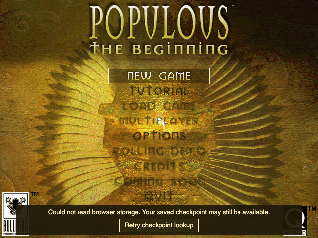
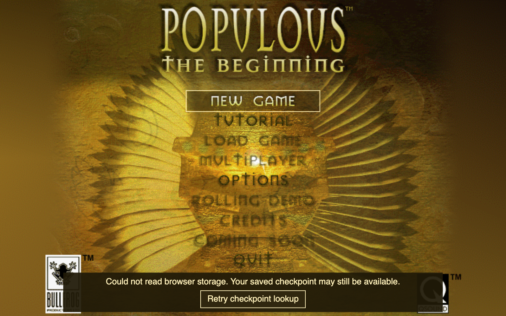
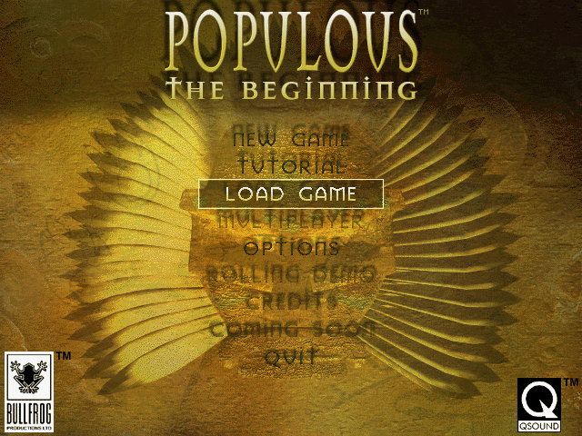
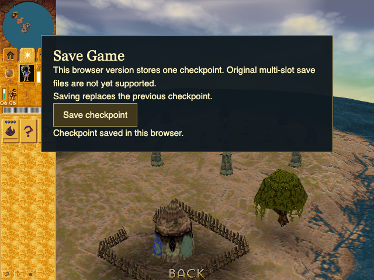

# Checkpoint recovery: final worker evidence

PR #500; source **9b959fa09fd86ac4cc2d72bbb95b92caefe09c93**, base **7e4806f25a7d202e67491186f1e62c648e379dab**. Production is byte-identical to independently reviewed 2a6ce1e26658c0503354fe4de6db05e2d8aa1fbd; the later commit corrects only focused navigation tests. [Source manifest](source-manifest.json) and [full diff](source.diff). The parent reported independent acceptance of focused tests, final behavioral scope, and settled visual evidence. This bundle is evidence only; it does not alter the PR source.

## Accepted evidence

- [Attempt 4 behavioral result](runs/checkpoint-recovery-attempt4/checkpoint-recovery.json), [source/dependency/browser receipt](runs/checkpoint-recovery-attempt4/receipt.json), [command receipt](commands/browser-attempt4.json): **passed**. Actual production Home through a Vite bundle. Public New Game/recommendation/Mission 1/intro flow and public Save create the real persistent checkpoint. Fresh documents reuse that original IndexedDB; no storage-state copy or model/world mutation.
- Four episodes: synchronous open failure → repeated abort → public Retry → deliberate Load; real transaction abort → repeated abort → Retry → Load; confirmed empty storage; delayed retry across public mission navigation and a newer public Save.
- Retry changes availability only. Read-only observers verify world/scene/canvas ownership and unchanged captured clocks. At the actual Load publication, restored level/turn/time/pause/RNG/unit state exactly matches the saved checkpoint, so a restart cannot pass. After delayed navigation, the retained world stays at turn 81/time 6.75 and the newer memory save wins over the earlier disk snapshot.
- Keyboard: Tab reaches Retry in nine presses; Enter and Space activate it. Pending controls disable, repeated pointer/keyboard attempts add no read. After removal, focus rests on Main menu and three Tabs reach Load; no focus trap.
- **Accepted visual evidence is the separate [settled layout probe](runs/checkpoint-layout-probe/layout.json), [command receipt](commands/layout-probe.json).** It reuses attempt 4's unchanged bundle, awaits the actual menu scale, two animation frames and a bounded settle, then captures 640×480 → 1440×900 → 640×480. All panel/button bounds fit, text does not overflow, no menu-control overlap; zero runtime errors/warnings. Screenshots were visually inspected.
- Attempt 4's immediate wide screenshots and wide measurements are **superseded visual evidence**: they captured a stale compositor strip before the resize settled. Its behavioral result remains accepted; do not use those wide PNGs to claim visual correctness.

## Images

All images below are candidate 9b959fa09fd86ac4cc2d72bbb95b92caefe09c93; “before” and “after” describe the public Retry interaction on that same source, not a fabricated baseline build comparison. No earlier-source rendered comparison was captured.

## Failed and diagnostic attempts retained

1. Attempt 1: failed seed setup waiting for Skip while the small-screen guidance remained visible.
2. Attempt 2: failed seed setup because the fixture tested Skip visibility before React rendered it. Both are fixture setup failures, not production defects.
3. Attempt 3: failed recovery after Playwright storageState copied the checkpoint incorrectly. It created the public save and passed preliminary recovery controls, but is not acceptance evidence.
4. [Isolated storage-copy diagnostic](runs/checkpoint-storage-copy-probe/probe.json): original public-save database and a fresh same-context page retain usable saves. Playwright's copied database converts five Maps and one Set to plain Objects, so it is unusable. Typed arrays survive. This isolated the cause without another broad rerun; the accepted attempt uses fresh documents over the original database.
5. Attempt 4: accepted behavior with the wide-capture qualification above; settled layout probe separately closes visual acceptance. All attempt runners/scenarios, receipts, logs and failure screenshots remain included. No failed status was rewritten.

## Limits and cleanup

- Browser recovery adaptation only: no native UI parity claim, no original executable runs, no simulated native rule. The fixture injects one bounded open throw, real transaction aborts, and a read-only transaction hold capped at 30 seconds. All holds release without timeout.
- No database writes were observed during recovery/empty episodes in this **unchanged-completion workload**. The navigation episode observes exactly one deliberate public Save put. This is not a universal promise: the store's existing update() can persist completion progress when world completion advances. No checkpoint deletion/reinitialization/overwrite is introduced by restore.
- Unsupported storage and malformed/incompatible records remain focused-test coverage; only genuine empty storage is browser-accepted here.
- Attempt 4: zero runtime/console errors including after context close; eight known Three warnings, all “Texture marked for update but no image data found.” Headless official Chrome 155.0.8059.80, sandbox enabled, managed temporary profile, no unsafe software-renderer switch. This is not hardware performance or Vinext/Cloudflare/RSC hosting acceptance.
- [Focused/typecheck/lint portable receipts](../checkpoint-recovery-checks-20261016/README.md): 30 focused tests pass after the test-only correction. Existing UI ESLint failures remain three errors/one warning on both base and candidate. Targeted store/test ESLint and formatting pass. No full local suite; parent-owned ready-PR full check/build gates remain required.
- [Cleanup/lane release](lane-cleanup.json): **2026-10-16T17:39:56.314Z**; no owned runner, no port 5198 listener, browser close confirmed. Tested bundle remains byte-identical after the settled layout probe. No further browser run or product change is needed.

## Hashes and replay

[artifact-index.json](artifact-index.json) distinguishes original local bytes from redacted published bytes for every copied receipt/log/script/image. Receipt-internal stdout/stderr hashes still name the original logs; published hashes are in the index. Redaction replaces checkout/home/temp prefixes only. Original raw files remain locally retained. Profiles, storageState payloads, dependency trees, bundle assets and credentials are excluded.

Replay in a fresh checkout of 9b959fa09fd86ac4cc2d72bbb95b92caefe09c93 with verified lockfile dependencies and official sandboxed Chrome: copy attempt 4's run-browser.mjs and browser-scenario.mjs into work/orchestration/checkpoint-recovery/, then run the recorded command with a fresh output directory. Its relative imports expect that location. Run the separate probe-layout.mjs against the newly generated bundle after updating its explicit output path; the recorded probe used outputs/checkpoint-recovery-attempt4/dist. The unchanged shared builder and Home fixture are tracked in the candidate repository. All runs require the shared browser lane.
