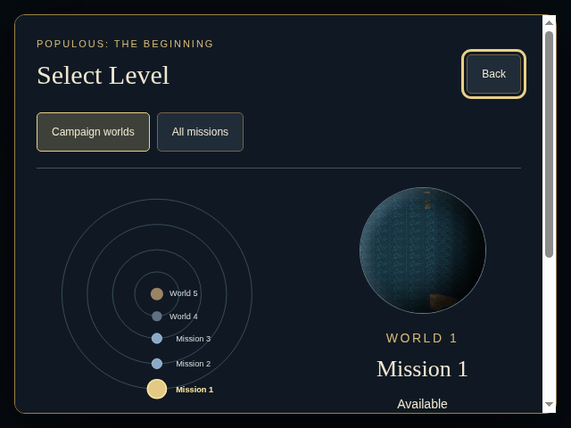
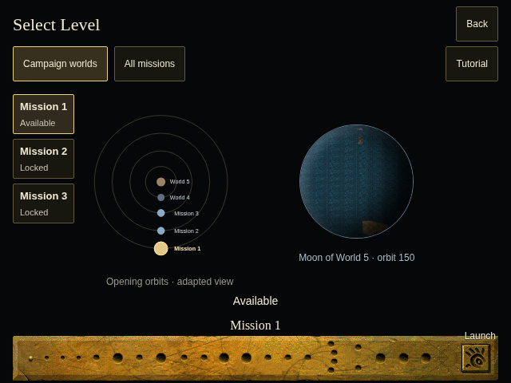
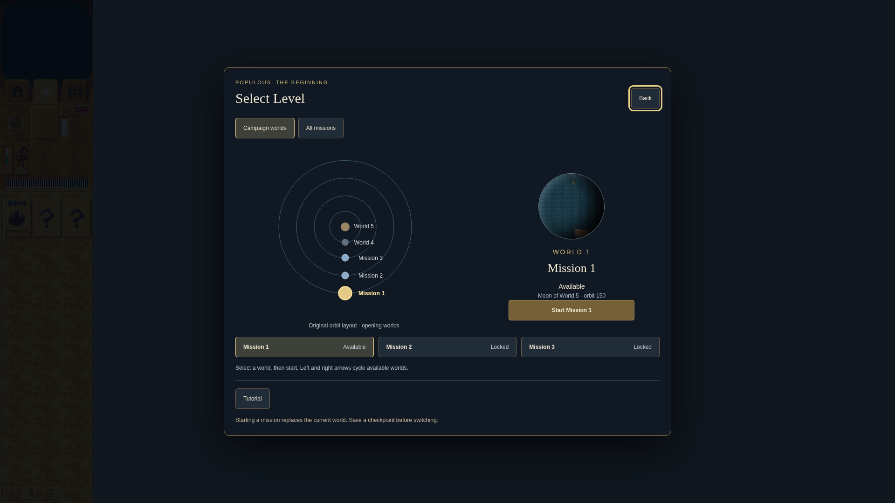
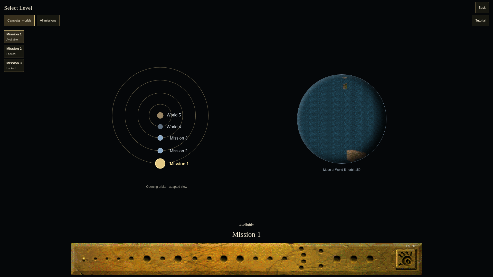

# World selector bottom-panel comparison

Refs #17 and #457; partial presentation slice, not full selector parity.

- Before: actual clean main `053cda0d35c8d508915cd74c7f07b7ed0ee66792`.
- After: actual clean `3b943abfe0b6ea79031c5b275c2c6475a75b75a4`.
- Same fresh-profile Mission1 selector,640×480 and1920×1080, DPR1.
  Focus differs: Back before, Mission1 after. Images are untouched captures.
- Sandboxed Chrome Headless Shell154.0.8037.92; frontend compositor.
  Battlefield lifecycle separately uses SwiftShader. No hardware performance or
  original native GPU screenshot claim.

## 640×480

Before: the former modal needs scrolling to reach campaign controls.

After: source `plspanel.spr` strip at(1,419), selected-palette available/completed
status overlays and hand launch; readable compatibility controls remain available.

## 1920×1080

## Evidence boundary

Original panel source/coordinates/palettes are retained in
[world-selector-panel](../../decomp/research/world-selector-panel/findings.md).
The existing orbit diagram, CSS globe projection/shading, Mission N title/font,
focus indicators, enlarged targets and compatibility controls remain adapted.
No guessed full-screen background or main-menu palette was introduced.

At the captured after head, frontend acceptance passed: exact panel/glyph geometry,
transparent hover/focus states, locked launch, keyboard/pointer selection, repeated
Escape/reopen, all23 direct choices, restored[1,2] profile replay/next3,390/640/1024/
1920/3440 viewport widths and1024×768 DPR2 capture. The restored profile is an
explicit screenshot/test fixture, not proof of natural victory.

A separate fresh gameplay episode passed actual Mission1 pointer launch and
in-mission selection return, preserving the same paused world object, turn and
level through Back/Escape. Combined large-capture/gameplay episodes crashed in the
headless renderer; these failures are retained, not counted as passes. A fresh
injected-art/atlas-failure episode reached real retry and checkpoint save but later
failed on stale test navigation. The corrected rerun crashed at retry startup.
Thus checkpoint load/Tutorial completion and a complete failure episode were still
unverified at this screenshot checkpoint. Final PR evidence reports later outcomes.
