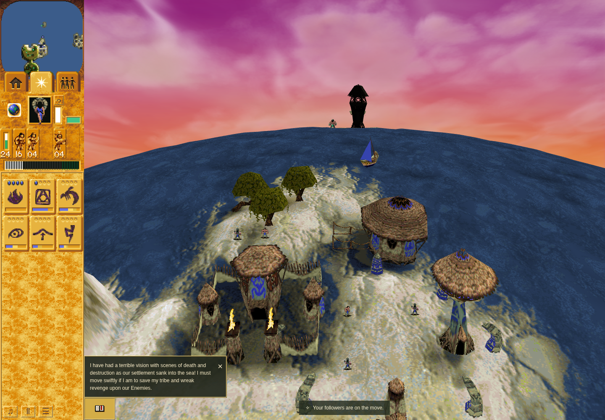
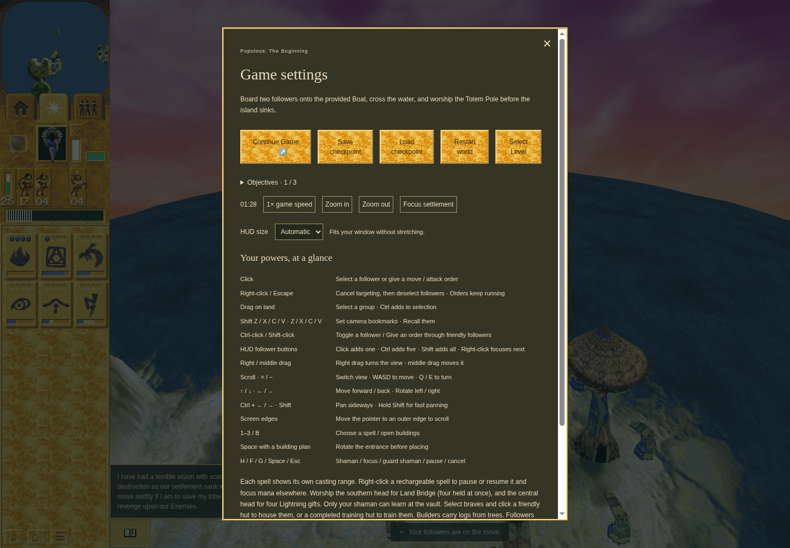
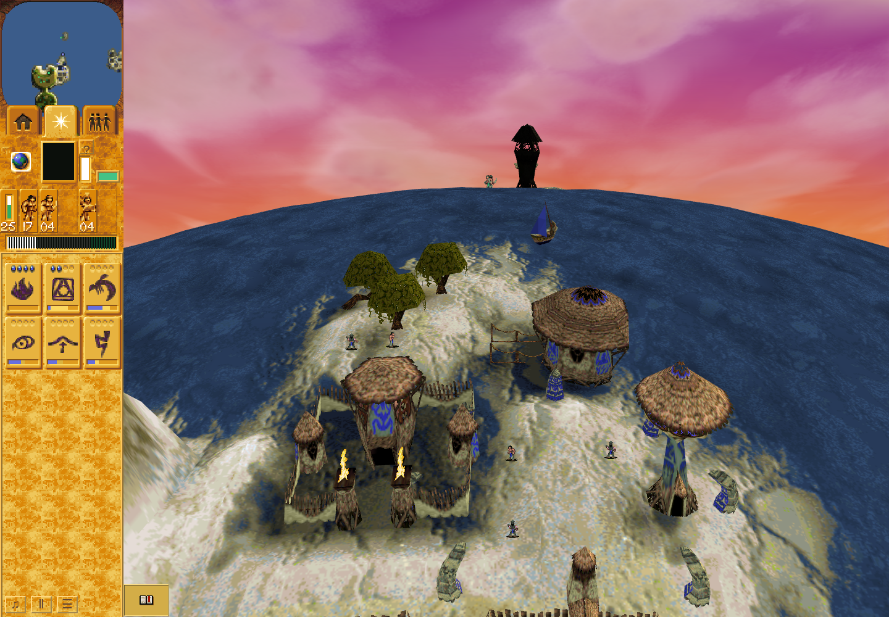
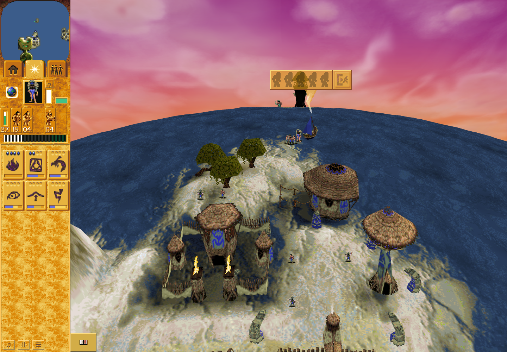

# M10 ordinary Boat browser checkpoint witness

Runtime: merged main `758fcb84d64f55670b3a407183ec94e5a4929b46`, unchanged application.
Save QA source: `cb2d73af2a92debdc6b9a0042513770a7697b17c`.
Final Load QA source: `6daeb09242a59f0545b7d45a3f21f76182b2a706`.

## Bounded result

PASS: authored Mission10 selected through the shipped All missions UI, ordinary
HUD selection of Shaman63 and Warriors111–114, minimap/mouse rally, actual boarding
of authored Boat62, public Save, complete browser termination, new browser process
with the same task-owned profile, public Load, ordinary right-click passenger panel,
public Unload all passengers, and natural physical landing of all five alive.

- Real RAF and normal game clock throughout; no direct tick, seeded outcome,
  imported CPU checkpoint, actor/stock edits, synthetic storage or forced drawing.
- Boarding observed at985; settings pause/public committed Save at1064 (88.667s
  game time). Single final Save click completed09:50:15.750–09:50:18.482 UTC.
- Load replacement boundary restores turn1064, matching actor identity/HP/position,
  terrain and stock component hashes. The recorded full checkpoint digest also
  matches; this script explicitly asserts the component set, not full World equality.
- Normal post-Load auto-resume observed at1135; all five alive, vehicle0 and
  airborne/impulse flags clear at1452 (121s game time). Boat passenger array empty.
- The real IndexedDB checkpoint remains `21100444d84eeed3a20467bc8eee18ab389fbb67d834e9bae730a2a0ab10f894`
  before and after final run. Final browser cleanup/continuation checks pass.
- Software WebGL2, ANGLE Vulkan SwiftShader/Subzero, Chrome Headless Shell
  154.0.8037.92. Sandbox enabled; Playwright defaults removed; only browser flag
  `--remote-debugging-pipe`. Actual renderer strings are in observations.

This proves same-shore unloading after genuine browser persistence. It does not
prove sea traversal, M10 victory, rendered Continue, campaign unlock/profile
completion, original-game parity, hardware frame pacing or cloud-reset survival.
Game-clock timestamps are not wall-clock performance measurements.

## Actual screenshots

The images were visually inspected. They are unchanged actual 1440×1000 captures,
not synthetic renders or pixel-matched before/after product comparisons.









## Retained failures

1. `failed-save`: first ordinary boarding1147 succeeded; menu pause1298. The one
   Save click timed out45s during action; terminal checkpoint read also timed out.
   Browser cleanup verified, but private profile01 remains locked because terminal
   storage provenance is unknown. Later success does not establish this failure's
   cause or justify retrying that profile.
2. `failed-readiness`: new profile02 never launched a browser. Vite listened after
   48s; HTTP did not become ready by the existing60s gate. Failure preserved.
3. `failed-dependency-layout`: private dependency copy had the wrong Node resolution
   directory structure; Vite could not resolve rolldown. No browser launched. The
   copy was moved under a real node_modules directory; no package source changed.
4. `load-hover-failure`: genuine public Load restored the occupied Boat, but the
   checker incorrectly hovered instead of right-clicking to open its panel. It
   failed visibly. Cleanup and unchanged committed checkpoint were verified.
   The correction only uses Escape, validates empty selection, and right-clicks
   the actual Boat. Independent exact-source correspondence is retained; no world
   or stored-save modification was needed.

## Reproduction

Use the existing sandbox-preserving harness with installed dependencies and the
verified browser from [recovery instructions](../../../engineering/cloud-render-recovery.md).
For a fresh final-source proof, run twice without changing any source/dependency
input; the second run only changes `--output` from `save` to `load`:

```
node scripts/local-render/harness.mjs --game-root "$PWD" \
  --browser /absolute/verified/chrome-headless-shell --port 4391 \
  --profile "$PWD/work/local-render-profiles/unique-m10-boat" \
  --scenario "$PWD/scripts/local-render/mission10-boat-checkpoint.mjs" \
  --output "$PWD/work/unique-m10-boat/save" --timeout 600000
```

Our actual development run uses the listed two QA commits and the retained
`inspection-correspondence.json` for its final Load. The immediately preceding
failed Load is preserved; it did not overwrite the saved checkpoint. Browser
profiles/raw storage are intentionally not included in this packet. Receipts
retain private local path references for provenance, but only bounded observations
and screenshots are published. No deployment/parity/runtime files changed.
