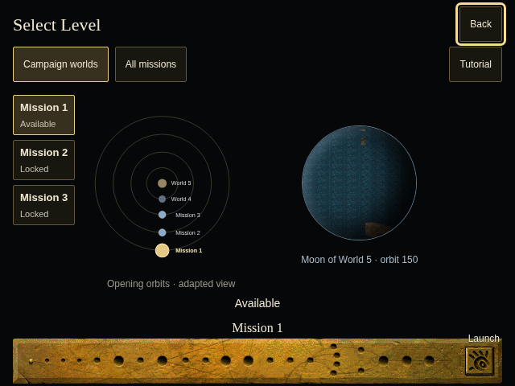
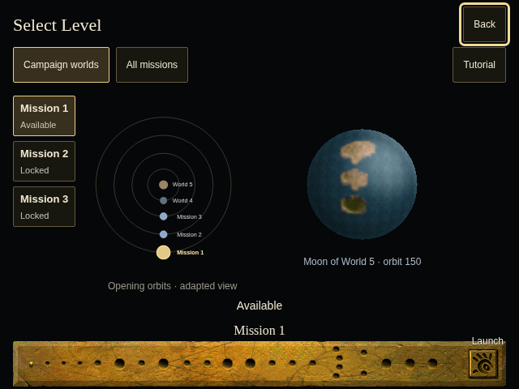
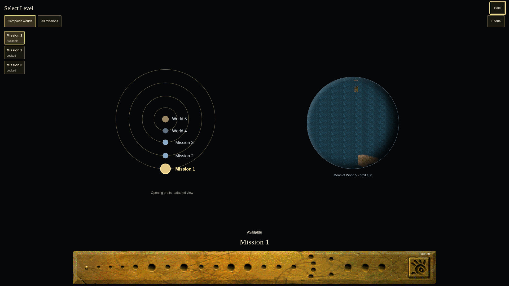
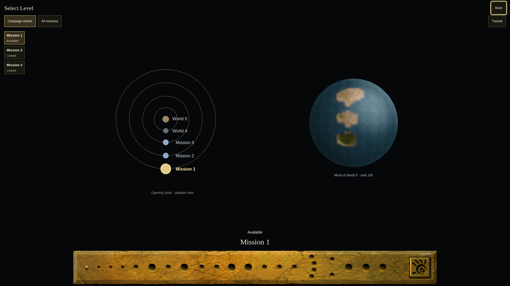

# Ordinary selector globe comparison

Before: actual shipped selector at main
`762be79c810d8ae5d9e05d8e44e283bdff94b47b`, Mission 1, fresh profile.
The old flat CSS crop used the selected-preview texture's linear layout.

After: actual shipped selector at
`0e10d80e887b4b1787254842fa49f066154d85e8`, same fresh Mission 1 and viewport.
Source-derived ordinary texture, ring geometry, radial UVs and interpolated vertex
shade are visible. The following commit only narrows a TypeScript buffer annotation
and adds evidence/tests; it does not change these rendered pixels.

Both are sandboxed Chromium Headless Shell frontend captures, at DPR1. These are
recreation screenshots, **not original-game screenshots**. Camera, globe placement,
diagram, fixed depth/UV pose, RGB8 bilinear repeat sampling and enabled specular are
adapted. No native full-screen pixel parity or hardware FPS claim.

## 640 × 480

## 1920 × 1080

The adjacent source-frozen receipts include source fingerprints, actual browser,
scenario and measured render checks. At 3840×2160/DPR2, the repaired cooperative
raster measured a maximum frame callback of 6.8ms across 20 callbacks, replacing
the synchronous prototype's 101–126ms static-raster microbenchmark cost. These are
different measurements: callback latency versus total CPU throughput, not a
claimed total-work speedup. Scanline batches preserve exact raster output and
cancel superseded resize/mission work; the prior complete image remains visible.
